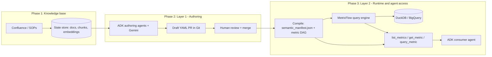

# Metric Authoring Agent POC: Development Plan

## 1. Purpose

Build an agent that reads Confluence pages that define metric formulas, drafts a MetricFlow YAML definition for each formula, and opens a pull request. A human reviewer approves every definition before it is merged into `main`. Approved definitions are compiled and made queryable by an AI agent.

There is no pre-existing set of hand-written reference metrics. The human reviewer is the judge of correctness; automated checks catch mechanical errors before review. Approved metrics accumulate into a regression set over time (see section 8).

Metric definitions are stored across three layers. This POC delivers Layers 1 and 2. Layer 3 is deferred.

| Layer | Role | Contents | POC scope |
|---|---|---|---|
| **Layer 1: Authoring** | Declarative source of truth, version controlled | MetricFlow YAML in Git (semantic models, entities, dimensions, measures, metrics, metadata) | **In scope** |
| **Layer 2: Runtime** | Compiled artifacts used by the query engine | `semantic_manifest.json`, metric dependency graph, MetricFlow query engine, agent tools | **In scope** |
| **Layer 3: Catalog and discovery** | Enterprise discovery, ownership, lineage | PostgreSQL registry, graph store, Atlan glossary, MCP server | Deferred |

**Fixed choices:** the agent uses **Google ADK** with **Gemini** models.
**Recommended target format:** **dbt MetricFlow** (Cube is the alternative).

**POC goal:** metrics are defined from formulas in Confluence, approved by humans through pull requests, and accessible to an agent that answers questions only through governed metrics.

## 2. Design principles

1. **The agent proposes, code validates, humans decide.** Nothing reaches `main` without human approval. Branch protection enforces this.
2. **Every field needs evidence.** Each definition cites a source page, its version, and an exact quote. Quotes are checked against the stored page text.
3. **Only stated formulas are drafted.** The agent drafts a metric only when a page contains an explicit formula or calculation rule. Sections that only mention a metric name are skipped and listed in the run report.
4. **No free-form YAML from the LLM.** The agent fills Pydantic models; a deterministic renderer writes the YAML.
5. **Conflicts are shown, not resolved silently.** Disagreeing sources become conflicts or open questions for the reviewer.
6. **Read-only data access.** Profiling queries are row-limited and cost-capped.
7. **Raw data stays in the warehouse.** The agent reads metadata and runs limited checks only. Authoring sees BigQuery metadata only; data checks run as deterministic code; only aggregated metric results reach the model (see section 5).
8. **The consumer agent has no raw SQL access.** It can only list, describe, and query approved metrics.

## 3. Architecture



## 4. Phases

### Phase 0: Scope and foundations (about 1 week)

**Goal:** agree on domain, formats, and access before writing agent code.

**Work**
- Choose the Confluence spaces, page labels, or page trees in scope, and one business domain to start with.
- Define what counts as a **formula**: an equation (`X = A / B`), a calculation sentence ("calculated as the sum of …"), or a formula table row. Write 5–10 real examples from the chosen pages; these become the detector's test cases, not an answer key.
- Define the **house schema**: MetricFlow YAML plus required `meta` fields (`owner`, `status`, `domain`, `formula_text`, `sources[]` with URL, page version, quote).
- Set up access: Confluence API token, Vertex AI in the same GCP project as BigQuery, Git repo with a bot account that can open PRs but not merge.
- Set up BigQuery access (see section 5): a read-only service account limited to authorized views over the in-scope datasets, policy tags on PII columns, and a per-query bytes-billed cap.
- Get security / data-governance sign-off on two questions: may aggregated metric results be sent to Vertex AI Gemini in our project, and which datasets and columns are PII or confidential.
- Set up the **merge gate** on `main`:
  - branch protection with at least one required approval
  - CODEOWNERS for metric owners per domain
  - required CI status checks (added in Phase 2)
  - the bot account excluded from approving its own PRs
- Create `metric-agent/` (agent code) and `semantic-layer/` (dbt project with metric YAML).

**Stack:** GitHub, dbt-core, dbt-duckdb, MetricFlow, Pydantic, Python 3.12, `uv`.

**Exit criteria:** the empty dbt project passes `dbt parse`; Confluence access works for the in-scope spaces; branch protection blocks a direct push and an unapproved merge to `main`.

---

### Phase 1: Knowledge base and ingestion (1–2 weeks)

**Goal:** the authoring agent can search and cite Confluence and SOP content.

**Work**
- Confluence ingester: crawl chosen spaces and labels; convert storage-format HTML to markdown, keeping tables; store page ID, version, URL, author, last-modified date.
- SOP ingester: docx and PDF to markdown.
- Heading-aware chunking that keeps the section path (for example "Finance KPIs > ARR > Definition").
- **Formula detection** on every chunk:
  - rules first: `=`, arithmetic operators between terms, "calculated as", "sum of", "divided by", "% of", formula table columns
  - Gemini Flash-tier classifier for chunks the rules flag as uncertain
  - stored as `formula_candidates` with the exact formula span, so the agent and the reviewer see the same text
- Hybrid index: keyword search plus Gemini embeddings.
- State store tables: `documents`, `document_versions`, `chunks`, `formula_candidates`, `embeddings`, `ingest_runs`.
- ADK function tools: `list_formula_candidates()`, `search_docs(query, k)`, `read_section(doc_id, section_path)`, `get_page_version(doc_id)`.

**Stack**

| Need | Tool |
|---|---|
| Confluence API | `atlassian-python-api` |
| HTML to markdown | `markdownify`, `BeautifulSoup` |
| SOP parsing | `docling` |
| Embeddings | Gemini embedding model via `google-genai` |
| State store | SQLite with `sqlite-vec` |
| Keyword search | SQLite FTS5 |

**Exit criteria:**
- All in-scope pages are ingested with their versions.
- The Phase 0 formula examples are all detected.
- A reviewer spot-checks 20 random formula candidates and confirms most are real formulas.
- A reviewer spot-checks 20 random non-candidate sections and finds few missed formulas.

---

### Phase 2: Authoring agent, building Layer 1 (2–3 weeks)

**Goal:** the agent drafts MetricFlow YAML with citations and opens a PR; a human approves it.

**ADK agent design**

```text
MetricAuthoringPipeline (SequentialAgent)
├── DiscoveryAgent (LlmAgent, Gemini Flash-tier)
│     tools: list_formula_candidates, read_section
│     → metric inventory (one entry per formula, synonyms merged)
├── PerMetricResearch (LoopAgent over the inventory)
│   ├── ResearchAgent (LlmAgent, Gemini Pro-tier)
│   │     tools: search_docs, read_section, list_tables,
│   │            describe_table, get_existing_metric
│   │     → evidence + candidate definition in state
│   ├── FormatterAgent (LlmAgent, output_schema=MetricDraft, no tools)
│   └── ValidatorStep (custom BaseAgent, deterministic)
│         → schema, citation, compile checks; loop back on failure
└── PublisherStep (custom BaseAgent)
      → YAML to branch, PR with evidence
```

Research and formatting are separate agents because an ADK agent with `output_schema` generally can't call tools.

**Work**
- Pydantic models: `MetricDraft`, `SemanticModelDraft`, `DimensionDraft`, `Evidence`, `OpenQuestion`, `Conflict`, with a deterministic YAML renderer.
- Schema tools: `list_tables`, `describe_table` (read-only), reading BigQuery `INFORMATION_SCHEMA` for the authorized views from the start of this phase, so drafts are validated against the real schema. They return metadata only (names, types, descriptions), never data rows.
- Guardrails via `before_tool_callback`: read-only SQL, row caps, no writes or DDL; every BigQuery job is dry-run first and runs with `maximum_bytes_billed`.
- Validators (deterministic):
  - Pydantic schema.
  - `formula_text` is a verbatim quote from the stored page version.
  - Every column in `expression` and `filter` exists in the BigQuery schema (a cached `INFORMATION_SCHEMA` snapshot in unit tests).
  - Every term in the quoted formula is mapped to a measure, column, or open question; nothing is silently dropped.
  - `dbt parse` and `mf validate-configs` pass.
  - No duplicate of an existing approved metric.
- **Formula critic** (Gemini, separate prompt): compares `formula_text` with the generated `expression` and filters and flags mismatches as open questions. It never edits the draft.
- PR publisher:
  - one PR per page (or per small group of related metrics), so each review stays small
  - PR description per metric: quoted formula, generated expression, source link and version, critic findings, conflicts, open questions
  - PR template with a reviewer checklist: formula matches source, filters and exclusions correct, grain correct, owner correct
- Review and merge:
  - CODEOWNERS route each PR to the domain's metric owners
  - required CI checks re-run the validators on every push, including reviewer edits
  - reviewers edit YAML directly in the PR or request a re-draft with a comment
  - merge to `main` only after approval and green checks; the merged YAML gets `status: approved`
- Run report per pipeline run: candidates found, drafted, skipped (and why), PRs opened.

**Stack:** Google ADK (`SequentialAgent`, `LoopAgent`, `LlmAgent`, custom `BaseAgent`, `FunctionTool`, callbacks), Gemini Pro-tier and Flash-tier (model IDs set by environment variable), Pydantic, `ruamel.yaml`, PyGithub, GitHub Actions, `adk web`.

**Exit criteria:**
- For the chosen domain, every formula candidate becomes a draft or a skip with a reason.
- All PRs pass CI; 100% of quotes are verified.
- Reviewers approve and merge most drafts with only small edits.
- At least one full cycle works end to end: draft, review edit, CI re-run, approval, merge to `main`.

---

### Phase 3: Compile, runtime, and agent access, building Layer 2 (2–3 weeks)

**Goal:** merged YAML becomes compiled artifacts, and an agent can list, describe, and query the approved metrics.

**Work: compile and runtime**
- CI on merge: `dbt parse` produces `target/semantic_manifest.json`; run `mf validate-configs`; store the manifest as a versioned artifact tagged with the commit.
- Metric DAG: load the manifest into NetworkX (metric → measure → semantic model → dimension → table) for dependency and impact checks.
- Query engine: MetricFlow with two dbt targets: `dev` (DuckDB with seed data, for local development and unit tests) and `bq` (`dbt-bigquery`, against the authorized views). `dbt parse` and `mf validate-configs` in CI need no warehouse connection.
- Data checks against BigQuery, run as deterministic code (never through an LLM); only pass/fail and totals appear in the PR:
  - primary-key uniqueness
  - join cardinality matches declarations
  - fan-out test (totals unchanged after joins)
  - **reconciliation** against numbers stated in Confluence or dashboards, for metrics where a page gives a reported figure; other metrics skip this check
- Add `preview_metric` to the Phase 2 `ValidatorStep` so drafts with a reported figure are reconciled before a PR opens.
- If CI runs data checks, it authenticates to GCP with Workload Identity Federation (no stored service-account keys).

**Work: agent access**
- Metric tools, implemented as ADK `FunctionTool`s:
  - `list_metrics()`: name, label, description, allowed dimensions, read from `semantic_manifest.json`.
  - `get_metric(name)`: full definition, filters, time grains, and source citations from `meta`.
  - `query_metric(metric, dimensions, filters, grain)`: runs through MetricFlow and returns rows plus the generated SQL. Results are aggregates only, row-capped, with a minimum group size (groups below N records are suppressed).
- Consumer agent: a separate ADK `LlmAgent` that uses only these three tools.
  - No raw SQL tool.
  - Identifier and PII columns (for example `customer_id`, `email`) are never declared as dimensions, so they cannot be grouped by.
  - Refuses or asks for clarification when a requested metric or dimension doesn't exist.
- Optional FastAPI wrapper (`GET /metrics`, `GET /metrics/{name}`, `POST /query`) if non-ADK clients need access.
- Consumer evaluation: business questions written from the approved metrics, with expected metric, dimensions, and result, run with `adk eval`.

**Stack:** dbt-core, MetricFlow, dbt-duckdb, dbt-bigquery, NetworkX, Google ADK, Gemini, FastAPI (optional), GitHub Actions artifacts or GCS.

**Exit criteria:**
- Every approved metric is queryable through `query_metric`.
- Reconciliation passes for every approved metric that has a reported figure.
- The consumer agent answers the evaluation questions using only governed metrics.

## 5. BigQuery data access and security

BigQuery is the warehouse. DuckDB is used only for local development and unit tests. The aim is to use the real tables without raw data leaving the warehouse.

**What leaves BigQuery**

| Step | What leaves BigQuery | Reaches Gemini? |
|---|---|---|
| Authoring schema tools (`list_tables`, `describe_table`) | Table and column names, types, descriptions | Yes, metadata only |
| Column-exists validator | Same metadata | No (deterministic code) |
| Data checks (PK, cardinality, fan-out, reconciliation) | Counts, sums, pass/fail | No (deterministic code) |
| Consumer `query_metric` | Aggregated metric rows | Yes; the model reads the result to answer |

**Controls**
- **Model inside the GCP boundary:** Gemini via Vertex AI in the same project as BigQuery, with a pinned region; optionally a VPC Service Controls perimeter around BigQuery and Vertex AI.
- **Least privilege, enforced in BigQuery:** a dedicated service account with `roles/bigquery.jobUser` and `roles/bigquery.dataViewer` on authorized views only (no write roles, no access to base tables); policy tags (column-level security) on PII columns; row-level security if some units are out of scope.
- **Aggregates only:** no raw SQL tool; `query_metric` goes through MetricFlow; row caps; minimum group size; no identifier or PII dimensions in semantic models.
- **Cost caps:** dry run before every job, `maximum_bytes_billed` per query, and a daily project quota.
- **Defence in depth:** `before_tool_callback` blocks DML/DDL even though the service account cannot write.
- **Auditability:** BigQuery audit logs record every query by the service account; Vertex AI request logging set according to policy.

**Fallback if aggregated results may not reach the LLM:** `query_metric` returns rows to the caller directly and gives the model only metadata (metric, dimensions, row count, generated SQL). The model still picks the metric but never sees the numbers.

## 6. Stack summary

| Area | Choice |
|---|---|
| Agent framework | Google ADK (authoring pipeline and consumer agent) |
| LLM | Gemini via Vertex AI (Pro-tier for research, Flash-tier for discovery and consumer agent, Gemini embeddings) |
| Warehouse | BigQuery (authorized views, policy tags, bytes-billed caps); DuckDB for local development and unit tests |
| Sources | `atlassian-python-api`, `markdownify`, `docling` |
| Layer 1: authoring | GitHub, dbt project with MetricFlow YAML, Pydantic, `ruamel.yaml`, PyGithub, CODEOWNERS, branch protection |
| Layer 2: runtime | `semantic_manifest.json`, MetricFlow, DuckDB and BigQuery, NetworkX DAG, ADK metric tools, FastAPI (optional) |
| State store | SQLite + `sqlite-vec` |
| CI/CD | GitHub Actions: schema, citation, compile, data checks, reconciliation |
| Review UI | GitHub PRs |

## 7. Timeline

| Phase | Duration | Delivers |
|---|---|---|
| 0. Scope and foundations | ~1 week | Scope, formula definition, house schema, access, merge gate |
| 1. Knowledge base | 1–2 weeks | Searchable Confluence content with detected formulas |
| 2. Authoring agent | 2–3 weeks | Approved MetricFlow YAML in Git (Layer 1) |
| 3. Compile, runtime, and agent access | 2–3 weeks | Manifest, query engine, consumer agent (Layer 2) |

Total: roughly 6–9 weeks for one domain.

## 8. Evaluation

There is no hand-written reference set. Quality is measured from the checks and from what reviewers do with each draft.

**Authoring**
- **Formula coverage:** share of formula candidates that became drafts; every skip has a reason.
- **Detector precision and recall:** from the Phase 1 reviewer spot checks.
- **Citation validity:** share of quotes present in their source (target 100%).
- **CI pass rate:** share of drafts that pass all validators on first submission.
- **Critic flags:** mismatches between quoted formula and expression, and how many reviewers confirmed.
- **Reconciliation pass rate:** for metrics with a reported figure.
- **Reviewer outcomes:** approved unchanged, approved with edits (and edit distance), re-draft requested, rejected, with the reason.

**Regression set built from approvals**
- Every merged metric, together with its source page version, becomes a regression case automatically.
- After each change to prompts, models, or tools, re-run the pipeline on those pages and compare drafts with the approved YAML.
- The set grows with each review cycle; no one writes it up front.

**Consumer agent (against business questions)**
- **Metric selection accuracy:** correct metric and dimensions chosen.
- **Answer correctness:** returned values match expected results.
- **Refusal correctness:** unknown metrics or dimensions are refused or clarified, not guessed.

## 9. Risks and mitigations

| Risk | Mitigation |
|---|---|
| Invented formulas | Only formula-bearing sections are drafted; `formula_text` must be a verified quote; agent writes `null` plus an open question instead of guessing |
| No reference answers at the start | Deterministic validators and the formula critic catch mechanical errors; reviewers judge meaning; approved metrics become the regression set |
| Reviewer fatigue or rubber-stamping | Small PRs per page, a checklist in the PR template, critic flags shown first |
| Formulas in prose the detector misses | Phase 1 spot checks of non-candidate sections; run report lists skipped sections |
| Conflicting documents | Explicit conflict records shown to reviewers |
| Wrong joins or fan-out | Cardinality profiling, fan-out tests, data engineer review |
| Stale definitions (no automatic re-sync in this POC) | Store page versions per citation; re-run the Phase 2 pipeline manually when sources change |
| Consumer agent bypassing governance | No raw SQL tool; only `list_metrics`, `get_metric`, `query_metric` |
| Sensitive content sent to the LLM | Review document sensitivity; use Vertex AI in your GCP project; restrict spaces |
| Warehouse data reaching the LLM | Authoring sees metadata only; data checks are deterministic; consumer sees aggregates only, with minimum group size and no PII dimensions; fallback mode keeps numbers out of the model (section 5) |
| Unsafe data access | Read-only service account on authorized views, policy tags on PII, dry run plus `maximum_bytes_billed`, row caps, tool callbacks blocking writes |

## 10. Deferred phases

These phases are out of scope for the POC. Bring them back when the trigger applies.

### Phase 4 (deferred): Catalog and discovery, Layer 3

**Contents**
- PostgreSQL registry of metrics, versions, owners, sources, reviews, status.
- Graph of metric → measure → semantic model → table → column.
- pgvector semantic search over metric names and descriptions.
- Atlan glossary publishing via `pyatlan`.
- MCP server exposing the Phase 3 tools to agents outside the ADK app.

**What the POC gives up:** discovery outside the consumer agent, search over large metric sets, ownership and audit views beyond Git history, Atlan visibility.

**Bring back when:** other teams or tools need to discover metrics; the metric count grows beyond what fits in a `list_metrics` response; Atlan must be the place where people find metrics; agents outside ADK need access.

### Phase 5 (deferred): Lifecycle and hardening

**Contents**
- Scheduled Confluence re-sync with diff PRs when cited pages change.
- Drift detection (deleted sources, changed columns, failing reconciliation).
- Deprecation flow.
- Governance reviews for access policies and PII.
- Observability (ADK tracing, OpenTelemetry, cost, acceptance rate).
- Production deployment (Cloud Run or Vertex AI Agent Engine, Cloud Scheduler, Secret Manager).

**What the POC gives up:** automatic freshness, monitoring, production readiness.

**Bring back when:** definitions must stay trusted over time, or the system moves beyond the POC.

## 11. Open decisions

**Decided**
- Confluence spaces: IT, BT, REVOPS, CSO (Salesforce revenue and billing formulas such as ACV and ARR).
- Formula detector examples quote internal pages, so they stay in a gitignored local fixtures file until the GitHub repository is private.
- Warehouse: BigQuery, with DuckDB for local development and unit tests; schema tools use BigQuery from Phase 2.
- Gemini access: Vertex AI in the same GCP project as BigQuery.
- Target format: MetricFlow.
- Review surface: GitHub PRs only (no Streamlit).

**Open**
- Domain owners for CODEOWNERS (currently the POC lead only).
- Private GitHub hosting (SailPoint organization or GitHub Pro) with branch protection, before any Confluence content is committed.
- GCP project, in-scope datasets, and whether a staging dataset exists for data checks.
- Security sign-off: may aggregated metric results reach Vertex AI Gemini? Which datasets and columns are PII or confidential?
- Per-query `maximum_bytes_billed` cap, daily quota, and minimum group size.
- Whether CI gets BigQuery access (via Workload Identity Federation) to run data checks.
- Whether the consumer agent needs the optional FastAPI wrapper.
