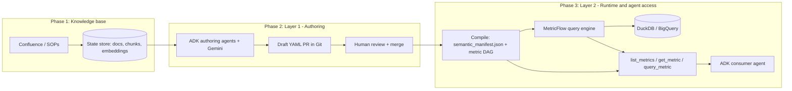

# Metric Authoring Agent POC: Development Plan

## 1. Purpose

Build an agent that reads Confluence pages, SOPs, and related documents and drafts metric definitions. A human reviews and approves every draft. Approved definitions are compiled and made queryable by an AI agent.

Metric definitions are stored across three layers. This POC delivers Layers 1 and 2. Layer 3 is deferred.

| Layer | Role | Contents | POC scope |
|---|---|---|---|
| **Layer 1: Authoring** | Declarative source of truth, version controlled | MetricFlow YAML in Git (semantic models, entities, dimensions, measures, metrics, metadata) | **In scope** |
| **Layer 2: Runtime** | Compiled artifacts used by the query engine | `semantic_manifest.json`, metric dependency graph, MetricFlow query engine, agent tools | **In scope** |
| **Layer 3: Catalog and discovery** | Enterprise discovery, ownership, lineage | PostgreSQL registry, graph store, Atlan glossary, MCP server | Deferred |

**Fixed choices:** the agent uses **Google ADK** with **Gemini** models.
**Recommended target format:** **dbt MetricFlow** (Cube is the alternative).

**POC goal:** metrics are defined from documentation, approved by humans, and accessible to an agent that answers questions only through governed metrics.

## 2. Design principles

1. **The agent proposes, code validates, humans decide.** Nothing reaches `main` without human approval.
2. **Every field needs evidence.** Each definition cites a source page, its version, and an exact quote. Quotes are checked against the stored page text.
3. **No free-form YAML from the LLM.** The agent fills Pydantic models; a deterministic renderer writes the YAML.
4. **Conflicts are shown, not resolved silently.** Disagreeing sources become conflicts or open questions for the reviewer.
5. **Read-only data access.** Profiling queries are row-limited and cost-capped.
6. **Raw data stays in the warehouse.** The agent reads metadata and runs limited checks only.
7. **The consumer agent has no raw SQL access.** It can only list, describe, and query approved metrics.

## 3. Architecture



## 4. Phases

### Phase 0: Scope and foundations (about 1 week)

**Goal:** agree on domain, formats, and access before writing agent code.

**Work**
- Choose one business domain with good Confluence coverage and known reported numbers (10–15 metrics).
- Build a **gold set**: 10–15 hand-written, approved metric definitions in MetricFlow YAML. This is the evaluation baseline.
- Define the **house schema**: MetricFlow YAML plus required `meta` fields (`owner`, `status`, `domain`, `sources[]` with URL, page version, quote).
- Set up access: Confluence API token, read-only warehouse service account, Gemini API key or Vertex AI project, Git repo with a bot account that can open PRs but not merge.
- Create `metric-agent/` (agent code) and `semantic-layer/` (dbt project with metric YAML).

**Stack:** GitHub, dbt-core, dbt-duckdb, MetricFlow, Pydantic, Python 3.12, `uv`.

**Exit criteria:** gold-set YAML passes `dbt parse` and `mf validate-configs`.

---

### Phase 1: Knowledge base and ingestion (1–2 weeks)

**Goal:** the authoring agent can search and cite Confluence and SOP content.

**Work**
- Confluence ingester: crawl chosen spaces and labels; convert storage-format HTML to markdown, keeping tables; store page ID, version, URL, author, last-modified date.
- SOP ingester: docx and PDF to markdown.
- Heading-aware chunking that keeps the section path (for example "Finance KPIs > ARR > Definition").
- Hybrid index: keyword search plus Gemini embeddings.
- State store tables: `documents`, `document_versions`, `chunks`, `embeddings`, `ingest_runs`.
- ADK function tools: `search_docs(query, k)`, `read_section(doc_id, section_path)`, `get_page_version(doc_id)`.

**Stack**

| Need | Tool |
|---|---|
| Confluence API | `atlassian-python-api` |
| HTML to markdown | `markdownify`, `BeautifulSoup` |
| SOP parsing | `docling` |
| Embeddings | Gemini embedding model via `google-genai` |
| State store | SQLite with `sqlite-vec` |
| Keyword search | SQLite FTS5 |

**Exit criteria:** searching each gold-set metric name returns the correct source section among the top results.

---

### Phase 2: Authoring agent, building Layer 1 (2–3 weeks)

**Goal:** the agent drafts MetricFlow YAML with citations and opens a PR; a human approves it.

**ADK agent design**

```text
MetricAuthoringPipeline (SequentialAgent)
├── DiscoveryAgent (LlmAgent, Gemini Flash-tier)
│     tools: search_docs, read_section
│     → metric inventory in session state
├── PerMetricResearch (LoopAgent over the inventory)
│   ├── ResearchAgent (LlmAgent, Gemini Pro-tier)
│   │     tools: search_docs, read_section, list_tables,
│   │            describe_table, get_existing_metric
│   │     → evidence + candidate definition in state
│   ├── FormatterAgent (LlmAgent, output_schema=MetricDraft, no tools)
│   └── ValidatorStep (custom BaseAgent, deterministic)
│         → schema, citation, compile checks; loop back on failure
└── PublisherStep (custom BaseAgent)
      → YAML to branch, PR with evidence
```

Research and formatting are separate agents because an ADK agent with `output_schema` generally can't call tools.

**Work**
- Pydantic models: `MetricDraft`, `SemanticModelDraft`, `DimensionDraft`, `Evidence`, `OpenQuestion`, `Conflict`, with a deterministic YAML renderer.
- Schema tools: `list_tables`, `describe_table` (read-only).
- Guardrails via `before_tool_callback`: read-only SQL, row caps, no writes.
- Validators: Pydantic schema, citation check against stored page version, `dbt parse` and `mf validate-configs`, duplicate check.
- PR publisher: one branch per domain run; PR description lists metrics, evidence links, conflicts, open questions.
- Review: GitHub PRs with CODEOWNERS; optional Streamlit screen showing YAML beside highlighted source quotes.
- Evaluation with `adk eval` against the gold set.

**Stack:** Google ADK (`SequentialAgent`, `LoopAgent`, `LlmAgent`, custom `BaseAgent`, `FunctionTool`, callbacks), Gemini Pro-tier and Flash-tier (model IDs set by environment variable), Pydantic, `ruamel.yaml`, PyGithub, GitHub Actions, Streamlit (optional), `adk web`.

**Exit criteria:** the agent opens a PR for the gold domain that compiles; every claim has a verified citation; reviewers accept most metrics with only small edits.

---

### Phase 3: Compile, runtime, and agent access, building Layer 2 (2–3 weeks)

**Goal:** merged YAML becomes compiled artifacts, and an agent can list, describe, and query the approved metrics.

**Work: compile and runtime**
- CI on merge: `dbt parse` produces `target/semantic_manifest.json`; run `mf validate-configs`; store the manifest as a versioned artifact tagged with the commit.
- Metric DAG: load the manifest into NetworkX (metric → measure → semantic model → dimension → table) for dependency and impact checks.
- Query engine: MetricFlow on DuckDB locally, BigQuery later.
- Data checks on staging data:
  - primary-key uniqueness
  - join cardinality matches declarations
  - fan-out test (totals unchanged after joins)
  - **reconciliation** against numbers stated in Confluence or dashboards
- Add `preview_metric` to the Phase 2 `ValidatorStep` so drafts are reconciled before a PR opens.

**Work: agent access**
- Metric tools, implemented as ADK `FunctionTool`s:
  - `list_metrics()`: name, label, description, allowed dimensions, read from `semantic_manifest.json`.
  - `get_metric(name)`: full definition, filters, time grains, and source citations from `meta`.
  - `query_metric(metric, dimensions, filters, grain)`: runs through MetricFlow and returns rows plus the generated SQL.
- Consumer agent: a separate ADK `LlmAgent` that uses only these three tools.
  - No raw SQL tool.
  - Refuses or asks for clarification when a requested metric or dimension doesn't exist.
- Optional FastAPI wrapper (`GET /metrics`, `GET /metrics/{name}`, `POST /query`) if non-ADK clients need access.
- Consumer evaluation: a set of business questions with expected metric, dimensions, and result, run with `adk eval`.

**Stack:** dbt-core, MetricFlow, dbt-duckdb, dbt-bigquery, NetworkX, Google ADK, Gemini, FastAPI (optional), GitHub Actions artifacts or GCS.

**Exit criteria:**
- Every approved metric is queryable through `query_metric`.
- Reconciliation passes for the gold set.
- The consumer agent answers the evaluation questions using only governed metrics.

## 5. Stack summary

| Area | Choice |
|---|---|
| Agent framework | Google ADK (authoring pipeline and consumer agent) |
| LLM | Gemini (Pro-tier for research, Flash-tier for discovery and consumer agent, Gemini embeddings) |
| Sources | `atlassian-python-api`, `markdownify`, `docling` |
| Layer 1: authoring | GitHub, dbt project with MetricFlow YAML, Pydantic, `ruamel.yaml`, PyGithub, CODEOWNERS, branch protection |
| Layer 2: runtime | `semantic_manifest.json`, MetricFlow, DuckDB and BigQuery, NetworkX DAG, ADK metric tools, FastAPI (optional) |
| State store | SQLite + `sqlite-vec` |
| CI/CD | GitHub Actions: schema, citation, compile, data checks, reconciliation |
| Review UI | GitHub PRs, optional Streamlit |

## 6. Timeline

| Phase | Duration | Delivers |
|---|---|---|
| 0. Scope and foundations | ~1 week | Gold set, house schema, access |
| 1. Knowledge base | 1–2 weeks | Searchable Confluence and SOP content |
| 2. Authoring agent | 2–3 weeks | Approved MetricFlow YAML in Git (Layer 1) |
| 3. Compile, runtime, and agent access | 2–3 weeks | Manifest, query engine, consumer agent (Layer 2) |

Total: roughly 6–9 weeks for one domain.

## 7. Evaluation

**Authoring (against the gold set)**
- **Discovery recall:** share of gold metrics found by the inventory.
- **Field accuracy:** formula, grain, filters, dimensions compared with gold.
- **Citation validity:** share of quotes present in their source (target 100%).
- **Reconciliation pass rate:** generated metrics reproduce reported numbers.
- **Reviewer acceptance rate** and **edit distance** from draft to approved version.

**Consumer agent (against business questions)**
- **Metric selection accuracy:** correct metric and dimensions chosen.
- **Answer correctness:** returned values match expected results.
- **Refusal correctness:** unknown metrics or dimensions are refused or clarified, not guessed.

## 8. Risks and mitigations

| Risk | Mitigation |
|---|---|
| Invented formulas | Quote verification; agent writes `null` plus an open question instead of guessing |
| Conflicting documents | Explicit conflict records shown to reviewers |
| Wrong joins or fan-out | Cardinality profiling, fan-out tests, data engineer review |
| Stale definitions (no automatic re-sync in this POC) | Store page versions per citation; re-run the Phase 2 pipeline manually when sources change |
| Consumer agent bypassing governance | No raw SQL tool; only `list_metrics`, `get_metric`, `query_metric` |
| Sensitive content sent to the LLM | Review document sensitivity; use Vertex AI in your GCP project; restrict spaces |
| Unsafe data access | Read-only service account, row and cost caps, tool callbacks blocking writes |

## 9. Deferred phases

These phases are out of scope for the POC. Bring them back when the trigger applies.

### Phase 4 (deferred): Catalog and discovery, Layer 3

**Contents**
- PostgreSQL registry of metrics, versions, owners, sources, reviews, status.
- Graph of metric → measure → semantic model → table → column.
- pgvector semantic search over metric names and descriptions.
- Atlan glossary publishing via `pyatlan`.
- MCP server exposing the Phase 3 tools to agents outside the ADK app.

**What the POC gives up:** discovery outside the consumer agent, search over large metric sets, ownership and audit views beyond Git history, Atlan visibility.

**Bring back when:** other teams or tools need to discover metrics; the metric count grows beyond what fits in a `list_metrics` response; Atlan must be the place where people find metrics; agents outside ADK need access.

### Phase 5 (deferred): Lifecycle and hardening

**Contents**
- Scheduled Confluence re-sync with diff PRs when cited pages change.
- Drift detection (deleted sources, changed columns, failing reconciliation).
- Deprecation flow.
- Governance reviews for access policies and PII.
- Observability (ADK tracing, OpenTelemetry, cost, acceptance rate).
- Production deployment (Cloud Run or Vertex AI Agent Engine, Cloud Scheduler, Secret Manager).

**What the POC gives up:** automatic freshness, monitoring, production readiness.

**Bring back when:** definitions must stay trusted over time, or the system moves beyond the POC.

## 10. Open decisions

- Target domain for the POC.
- Warehouse for Phase 3 beyond local DuckDB (BigQuery assumed).
- MetricFlow or Cube (MetricFlow assumed).
- Review surface: PRs only, or PRs plus Streamlit.
- Whether the consumer agent needs the optional FastAPI wrapper.
